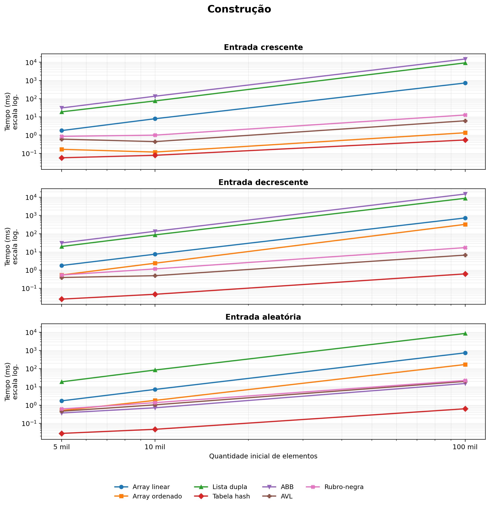
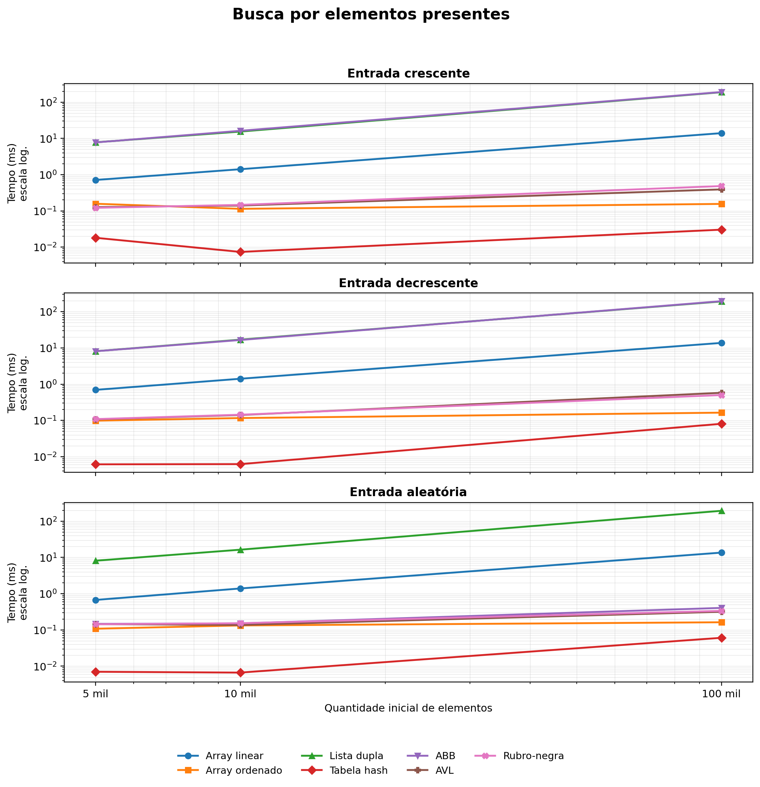
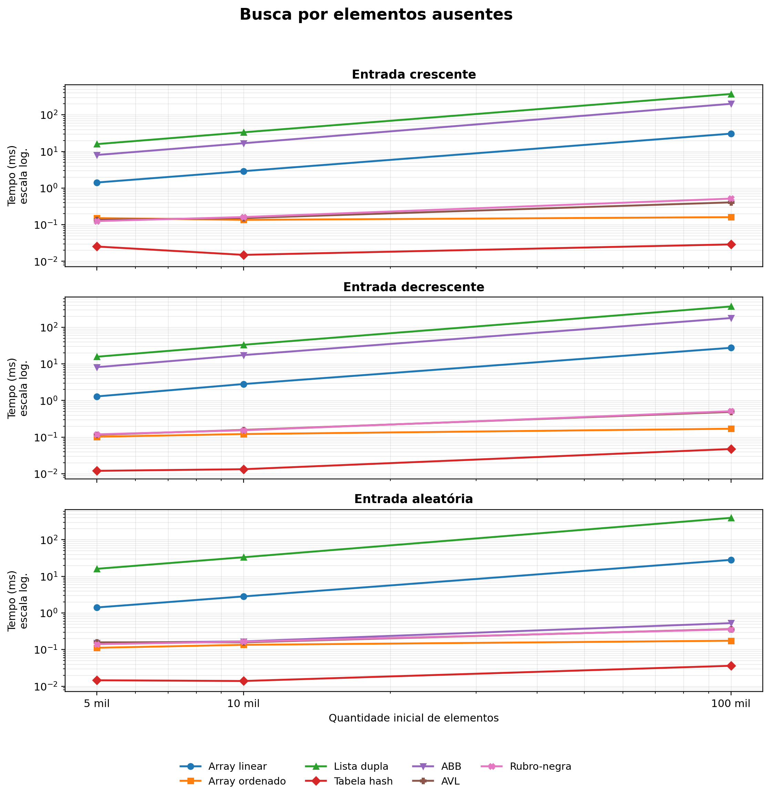
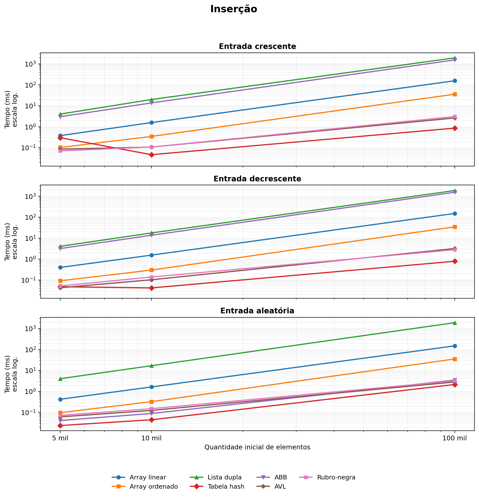
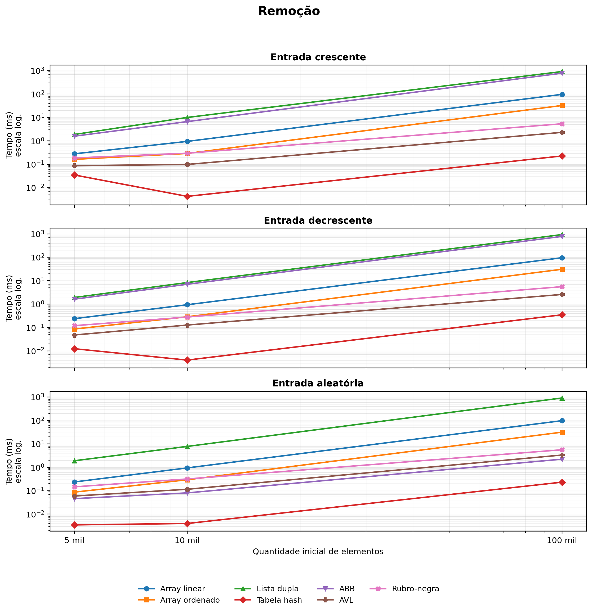
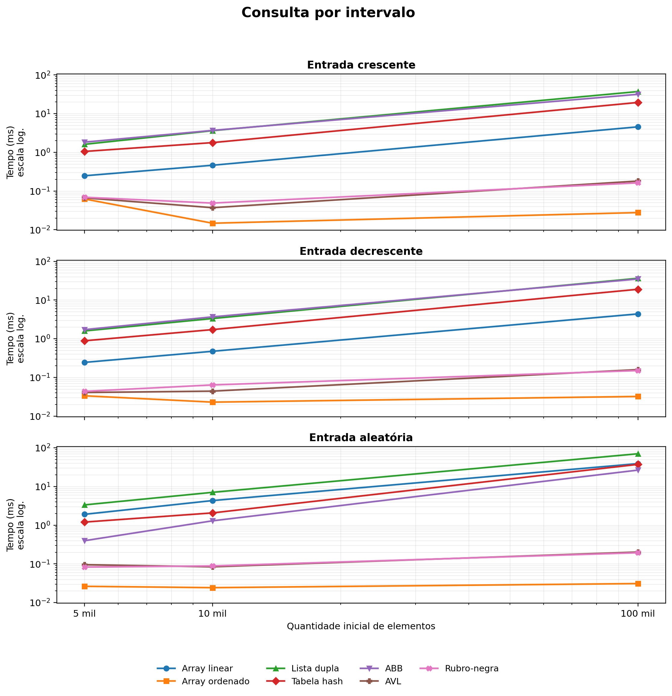

# Comparação de desempenho entre estruturas de dados

**7 estruturas · 6 operações · 1.890 medições**

Projeto da disciplina de **Estrutura de Dados II**, do Bacharelado em Ciência da Computação do **Instituto Federal Catarinense — Campus Rio do Sul**, desenvolvido por **Carlos Fontanive e Diogo Lohn** em 2026.

O trabalho compara implementações em Java submetidas aos mesmos dados e operações. A análise considera o tamanho da entrada, a ordem de inserção e o comportamento esperado de cada estrutura, relacionando os tempos medidos aos custos de busca, deslocamento e balanceamento.

[Relatório completo em PDF](docs/relatorio.pdf) · [Resultados brutos](resultados/resultados_brutos.csv) · [Resumo das medianas](resultados/resumo.csv)

## Estruturas implementadas

As sete implementações seguem a interface [`EstruturaDados`](src/br/edu/ifc/estruturas/EstruturaDados.java), que define inserção, busca, exclusão, contagem em intervalo, tamanho e nome. Todas rejeitam valores duplicados e foram implementadas sem utilizar coleções prontas para representar as estruturas comparadas.

| Estrutura | Características |
| --- | --- |
| [Array linear](src/br/edu/ifc/estruturas/ArrayLinear.java) | Valores sem ordenação; busca e consulta por intervalo sequenciais. |
| [Array ordenado](src/br/edu/ifc/estruturas/ArrayOrdenado.java) | Busca binária; inserções e remoções podem deslocar elementos. |
| [Lista duplamente encadeada](src/br/edu/ifc/estruturas/ListaDuplamenteEncadeada.java) | Nós com referências para o anterior e o próximo; busca sequencial. |
| [Tabela hash](src/br/edu/ifc/estruturas/TabelaHash.java) | Colisões por encadeamento separado, capacidade prima e fator de carga máximo de 0,75. |
| [Árvore binária de busca](src/br/edu/ifc/estruturas/ArvoreBinariaDeBusca.java) | Sem balanceamento; pode degenerar em uma cadeia com entradas ordenadas. |
| [Árvore AVL](src/br/edu/ifc/estruturas/ArvoreAVL.java) | Balanceamento por alturas e rotações após inserções e remoções. |
| [Árvore rubro-negra](src/br/edu/ifc/estruturas/ArvoreRubroNegra.java) | Balanceamento por regras de coloração e rotações. |

## Metodologia

Cada estrutura recebe conjuntos de **5.000, 10.000 e 100.000 elementos**, nas ordens **crescente, decrescente e aleatória**. Os valores iniciais são pares distintos, de `2` até `2n`; valores ausentes e novas inserções são ímpares.

| Operação | Carga de trabalho por medição |
| --- | --- |
| Construção | Inserção dos `n` elementos iniciais. |
| Busca presente | 2.000 buscas por valores do conjunto inicial. |
| Busca ausente | 2.000 buscas por valores que não pertencem ao conjunto. |
| Inserção | Novos valores distintos equivalentes a 10% de `n`. |
| Remoção | Exclusão de valores equivalentes a 10% de `n`. |
| Consulta por intervalo | 200 contagens em intervalos inclusivos de amplitude 100. |

Para cada cenário, o programa descarta **uma execução de aquecimento** e realiza **cinco repetições medidas**, reconstruindo a estrutura a cada repetição. Os dados são gerados antes da cronometragem, feita com `System.nanoTime()`, e as impressões e gravações ocorrem fora do trecho medido. Os resultados das operações são conferidos automaticamente.

As sementes são fixas e independentes: `42` para a ordem inicial, `43` e `44` para buscas presentes e ausentes, `45` para inserções, `46` para remoções e `47` para intervalos.

```text
3 tamanhos × 3 ordens × 7 estruturas × 6 operações × 5 repetições
= 1.890 medições, agrupadas em 378 cenários
```

### Ambiente utilizado no relatório

| Componente | Especificação |
| --- | --- |
| Processador | Intel Core i5-13420H de 13ª geração |
| Memória RAM | 24 GB |
| Sistema operacional | Arch Linux, kernel 7.2.11-arch1-1 |
| Java | OpenJDK 27.0.1.0.3, 64 bits |
| Máquina virtual | OpenJDK 64-Bit Server VM, modo misto e compartilhado |

## Principais resultados

No conjunto de experimentos, a **tabela hash** obteve o menor tempo nas nove combinações de tamanho e ordem para construção, buscas presentes, buscas ausentes e remoção, além de sete das nove combinações de inserção. O **array ordenado** venceu as nove consultas por intervalo.

A tabela abaixo apresenta as menores medianas para **entrada aleatória com 100.000 elementos**. Os tempos correspondem à carga completa de cada operação, definida na metodologia.

| Operação | Estrutura mais rápida | Mediana do tempo total (ms) |
| --- | --- | ---: |
| Construção | Tabela hash | 0,630 |
| Busca presente | Tabela hash | 0,061 |
| Busca ausente | Tabela hash | 0,036 |
| Inserção | Tabela hash | 2,134 |
| Remoção | Tabela hash | 0,232 |
| Consulta por intervalo | Array ordenado | 0,031 |

A ordem de entrada teve forte impacto na árvore binária sem balanceamento: construir 100.000 elementos levou aproximadamente **15 segundos** com dados ordenados e **15 milissegundos** com dados aleatórios. AVL e rubro-negra mantiveram desempenho mais estável graças ao balanceamento.

No array linear e na lista, a verificação de duplicatas exige buscas sequenciais repetidas, tornando a construção quadrática. No array ordenado, a busca binária favorece consultas, enquanto o deslocamento de elementos aumenta o custo de inserções e remoções.

### Gráficos por operação

Os gráficos do relatório mostram a **mediana do tempo total em milissegundos**. Cada imagem reúne as três ordens de entrada; os eixos de tempo e tamanho usam escala logarítmica. **Quanto menor o tempo, melhor.** Expanda uma operação para visualizar o gráfico.

<details open>
<summary><strong>Construção</strong> — efeito da ordem de entrada</summary>

A tabela hash foi a mais rápida em todos os cenários. Na árvore binária de busca, entradas ordenadas formaram cadeias e aumentaram o custo da construção.



</details>

<details>
<summary><strong>Busca por elementos presentes</strong> — 2.000 consultas</summary>

Tabela hash e array ordenado se destacaram. As árvores balanceadas mantiveram tempos baixos nas três ordens, enquanto a árvore sem balanceamento perdeu desempenho nas entradas ordenadas.



</details>

<details>
<summary><strong>Busca por elementos ausentes</strong> — 2.000 consultas</summary>

Array linear e lista precisam percorrer todos os elementos para confirmar a ausência. A tabela hash manteve os menores tempos.



</details>

<details>
<summary><strong>Inserção</strong> — acréscimo de 10% de elementos</summary>

Tabela hash, AVL e rubro-negra apresentaram os menores tempos para 100.000 elementos iniciais. Na lista e no array linear, a busca por duplicatas contribuiu para o custo das inserções.



</details>

<details>
<summary><strong>Remoção</strong> — exclusão de 10% dos elementos</summary>

A tabela hash foi a mais rápida nos nove cenários. As árvores balanceadas evitaram a degradação observada na árvore binária de busca com entradas ordenadas.



</details>

<details>
<summary><strong>Consulta por intervalo</strong> — 200 contagens em faixas inclusivas</summary>

O array ordenado localiza os limites por busca binária e venceu todas as combinações. AVL e rubro-negra também se beneficiaram da ordenação; a tabela hash precisou percorrer os elementos para contar os valores de cada faixa.



</details>

### Interpretação e limites

Os resultados favorecem a tabela hash para operações com chave exata, o array ordenado para consultas em faixas e as árvores balanceadas para conjuntos dinâmicos que precisam manter ordenação. A escolha depende das operações predominantes e da ordem de chegada dos dados.

Os tempos refletem as implementações e a máquina descritas no relatório. Uma execução de aquecimento e a mediana de cinco repetições reduzem oscilações, mas não eliminam efeitos da compilação JIT, da coleta de lixo e da atividade do sistema. O estudo mede tempo de execução, sem avaliar consumo de memória.

## Como executar

É necessário ter o **JDK 26 ou superior** instalado. O programa Java não utiliza bibliotecas externas.

Na raiz do projeto, compile e execute:

```bash
javac -encoding UTF-8 -sourcepath src -d out src/br/edu/ifc/Main/Main.java
java -cp out br.edu.ifc.Main.Main
```

No IntelliJ IDEA, abra o projeto, configure o JDK e execute a classe `br.edu.ifc.Main.Main`.

A execução começa com os testes funcionais das sete estruturas, realiza os experimentos e grava os CSVs em `resultados/`. O experimento completo pode demorar, especialmente nos cenários com 100.000 elementos e estruturas de custo quadrático.

## Dados e relatório

| Arquivo | Conteúdo |
| --- | --- |
| [`resultados/resultados_brutos.csv`](resultados/resultados_brutos.csv) | 1.890 medições com cenário, repetição, quantidade de operações e tempo total em nanossegundos. |
| [`resultados/resumo.csv`](resultados/resumo.csv) | 378 cenários com a mediana do tempo total em milissegundos e do tempo por operação em nanossegundos. |
| [`docs/relatorio.pdf`](docs/relatorio.pdf) | Relatório completo com metodologia, discussão dos resultados e referências. |
| [`docs/figuras/`](docs/figuras/) | Os seis gráficos do relatório em PNG. |

Os CSVs usam ponto e vírgula como separador e incluem cabeçalho. Uma nova execução substitui os CSVs; o PDF e as imagens representam os resultados da execução analisada no relatório.

## Organização do projeto

```text
Comparacao_Estrutura_de_Dados/
├── src/br/edu/ifc/
│   ├── estruturas/    # Interface, sete implementações, tipos e fábrica
│   ├── experimento/   # Geração de dados, testes, medições e exportação CSV
│   └── Main/          # Ponto de entrada do programa
├── resultados/        # Medições brutas e resumo das medianas
└── docs/
    ├── figuras/       # Gráficos apresentados no README
    └── relatorio.pdf  # Relatório completo
```

## Referências

- CORMEN, Thomas H. et al. *Algoritmos: teoria e prática*. 3. ed. Rio de Janeiro: Elsevier, 2012.
- SEDGEWICK, Robert; WAYNE, Kevin. *Algorithms*. 4. ed. Boston: Addison-Wesley, 2011.
